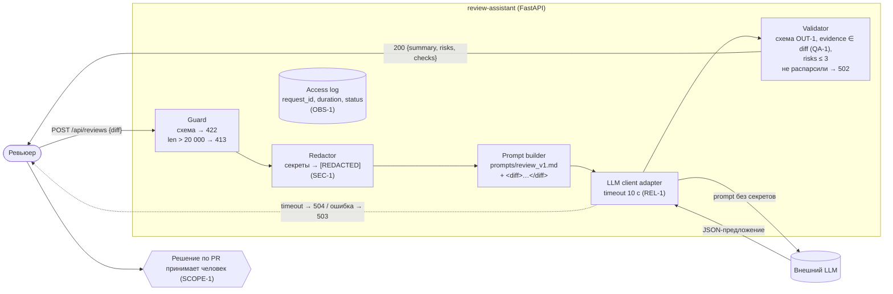

# ADR-001: конвейер «guard → LLM → validate» для `POST /api/reviews`

- Статус: proposed
- Дата: 2026-09-18
- Ответственные: Даниил Антонов (автор), ревьюер команды (утверждает)

## Контекст

Первая версия помощника ([`TRAINING_PR.diff`](TRAINING_PR.diff)) — «тонкий прокси»: `app/api.py:10` передаёт `payload["diff"]` в `ReviewService.review`, который в `app/review_service.py:14–16` подставляет diff в prompt и возвращает сырой текст модели как `{"comment": ...}`. Такая схема нарушает SEC-1 (секреты уходят в LLM), API-1 (нет лимита), REL-1 (нет timeout), OUT-1 (нет структуры) и не даёт выполнить QA-1 (нельзя отбросить неподтверждённый риск). Это подтверждено запуском P1-02 в [`prompts.md`](prompts.md).

Ограничения: сервис только советует (SCOPE-1); LLM внешний и недетерминированный; в логах нельзя хранить diff (OBS-1); первый сценарий должен быть готов за ~2 недели ([`project_management.md`](project_management.md)).

## Решение

Обработка запроса — последовательный конвейер с детерминированными шагами до и после LLM. LLM — единственный недетерминированный шаг, и его вывод никогда не отдаётся пользователю без проверки.

1. **Guard (API-слой, `app/api.py`)**: Pydantic `ReviewRequest(diff: str)` → 422; `len(diff) > 20_000` → 413 до любых вызовов.
2. **Redactor (`app/redaction.py`, чистая функция)**: заменяет токены, пароли и приватные ключи на `[REDACTED]` по списку паттернов (SEC-1).
3. **Prompt builder**: master prompt из `prompts/review_v1.md` в репозитории + diff в явных разделителях `<diff>…</diff>`.
4. **LLM client adapter**: единственная точка вызова провайдера, timeout 10 с; timeout → `LLMTimeout` → 504, ошибка провайдера → `LLMUnavailable` → 503 (REL-1).
5. **Validator**: парсит JSON по схеме `ReviewResponse` (OUT-1); отбрасывает риски, у которых `evidence` (без ведущих маркеров diff `+`/` `) нет в исходном diff (QA-1); обрезает до 3 рисков. Если ответ модели не парсится или после фильтрации не осталось ни `summary`, ни рисков — 502 с коротким сообщением без текста модели.
6. **Access log middleware**: пишет только `request_id`, `duration_ms`, `status` (OBS-1).

## Рассмотренные альтернативы

| Альтернатива | Почему не выбрали сейчас |
|---|---|
| A-PROXY. Оставить тонкий прокси из PR, правила описать только в prompt | Prompt не гарантирует ни SEC-1 (секрет уже ушёл провайдеру), ни OUT-1/QA-1: P1-02 показал, что даже с master prompt модель ошибается в номерах строк на 1. Проверки должны быть в коде |
| B-LINT. Детерминированный линтер правил без LLM (regex/AST) | Надёжно ловит SEC-1/API-1, но не пишет summary и не находит смысловые риски — теряется ценность помощника. Используем как часть решения (Redactor, Validator), а не вместо LLM |
| C-QUEUE. Асинхронная очередь (job + polling результата) | Решает длинные запросы, но добавляет хранилище, статусы и второй эндпоинт. При лимите 20 000 символов и timeout 10 с синхронного ответа достаточно; вернуться, если p95 > 12 с на пилоте |

### Под-решение: как реализовать SEC-1 (Redactor)

Выбрано с помощью Tree of Thoughts ([`../practice_02/tree_of_thoughts/experiment.md`](../practice_02/tree_of_thoughts/experiment.md)). Критерии и веса: K1 гарантия, что секрет не уйдёт (0.4), K2 польза ревью (0.25), K3 срок внедрения в инкременте 1 (0.2), K4 тестируемость без сети (0.15).

| Вариант | K1 | K2 | K3 | K4 | Сумма | Итог |
|---|---:|---:|---:|---:|---:|---|
| SEC-A. Собственные regex-паттерны в `app/redaction.py` | 3 | 4 | 5 | 5 | 3.95 | **Выбран** для инкремента 1 |
| SEC-B. Правила сканера секретов (detect-secrets / gitleaks) как библиотека | 4 | 3 | 3 | 4 | 3.55 | Отложен: используем его публичные правила как источник для корпуса паттернов A |
| SEC-C. Отклонять diff с секретом (422), без редактирования | 4 | 2 | 4 | 5 | 3.65 | Отклонён: diff с тестовыми фикстурами ключей блокируется целиком, а незнакомый формат секрета C пропускает так же, как A |

Худший сценарий для SEC-A — секрет незнакомого формата; он же остаётся главным риском решения (ниже). Предложение модели «исключать из редактирования файлы фикстур по пути» отклонили: настоящие секреты тоже попадают в тестовые каталоги.

## Последствия и главный риск

- Положительные последствия: правила SEC-1, API-1, REL-1, OUT-1, QA-1, OBS-1 проверяются кодом и unit-тестами без сети; LLM заменяется через адаптер; master prompt версионируется в репозитории.
- Ограничения: diff > 20 000 символов не обрабатывается вовсе; сверка evidence по подстроке может отбросить верный риск, если модель изменит пробелы; redaction по паттернам не ловит «неизвестные» форматы секретов.
- Главный риск: **Redactor пропускает секрет нового формата, и он уходит во внешний LLM** — это единственное необратимое последствие в системе.
- Как проверим риск: корпус из ≥ 30 канареечных секретов разных форматов (GitHub/AWS/JWT/PEM/пароли в URL) в [`tests_unit.md`](tests_unit.md) U-01/U-02, прогон на каждом CI; подставной LLM в INT-04 сохраняет полученный prompt, тест падает при любом совпадении с корпусом. Новые форматы добавляет команда безопасности.

## Архитектурная схема

## Как использовали AI

- Для чего: проверить, какие правила нарушает тонкий прокси (P1-02), получить формулировку главного архитектурного риска (P1-03) и сравнить три способа реализации SEC-1 (Tree of Thoughts, Практика 2, E2-04).
- Тип промпта: master prompt; Tree of Thoughts.
- Строка в [`prompts.md`](prompts.md): P1-02, P1-03; [`../practice_02/prompts.md`](../practice_02/prompts.md) E2-04.
- Что проверили и исправили сами: пересчитали взвешенные суммы ToT (совпали); не согласились с оценкой «B — тяжёлая интеграция» для detect-secrets (это pip-пакет), но оставили выбор A из-за K2 и срока. Альтернативы B и C и решение «проверки в коде, а не в prompt» сформулировали сами на основе ошибки модели в номерах строк в P1-02; главный риск сверили с правилами — выбрали SEC-1 как единственное необратимое последствие.
