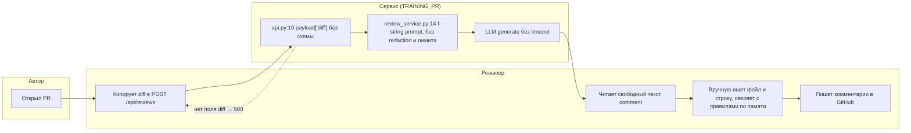
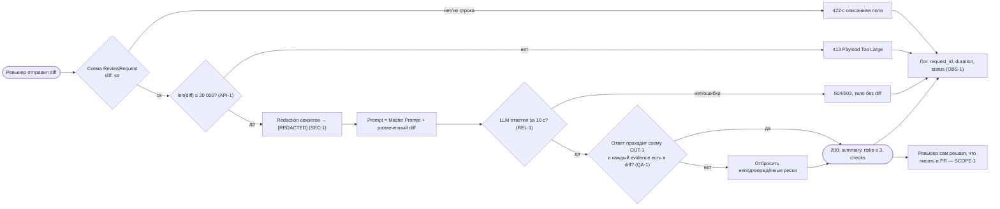

# Анализ процесса: AS IS и TO BE

Нотация: BPMN-подобный flowchart в Mermaid (дорожки — через subgraph), рендерится в GitHub.

## AS IS

Процесс ревью одного PR сейчас (с первой версией помощника из [`TRAINING_PR.diff`](TRAINING_PR.diff)):

| Шаг | Участник | Ручная операция / задержка | Точка потери информации |
|---|---|---|---|
| Отправка diff | Ревьюер | Копирование diff вручную | Diff любого размера, в т.ч. с секретами, уходит дальше |
| Разбор запроса | Сервис, `app/api.py:9–10` | — | Пустое тело → `KeyError` → 500 без объяснения |
| Формирование prompt | Сервис, `app/review_service.py:14` | — | Секреты из diff уходят во внешний LLM (нарушение SEC-1) |
| Вызов LLM | Сервис, `app/review_service.py:15` | Ожидание без предела (REL-1) | Ошибка провайдера → неконтролируемый 500 |
| Чтение ответа | Ревьюер | Поиск файла/строки и правила для каждого замечания | Нет `file`, `line`, `evidence` (OUT-1, QA-1) — 14 замечаний в P1-01 не проверить быстро |

## TO BE

Один небольшой процесс после изменения — обработка запроса на ревью внутри сервиса:

## Разница

| Что меняется | AS IS | TO BE | Как проверим изменение |
|---|---|---|---|
| Валидация входа | `payload: dict`, `payload["diff"]` → 500 на `{}` | Pydantic `ReviewRequest`, 422 | E2E-02 в [`tests_e2e.md`](tests_e2e.md): `{}` → 422 |
| Размер diff | Не ограничен | > 20 000 символов → 413, LLM не вызывается | U-03/U-04 в [`tests_unit.md`](tests_unit.md), E2E-03 |
| Секреты | Уходят во внешний LLM | Заменяются на `[REDACTED]` до вызова LLM | U-01/U-02: подставной LLM сохраняет prompt |
| Timeout LLM | Нет | 10 с, контролируемый 504/503 | INT-02 в [`tests_integration.md`](tests_integration.md) |
| Формат ответа | `{"comment": str}` | `summary`, `risks` (≤ 3, `file/line/evidence/risk`), `checks` | INT-01, U-05 |
| Проверяемость рисков | Ревьюер ищет строку сам | Риск без дословного evidence отбрасывается (QA-1) | U-06, INT-03 |
| Логи | Не определены | Только `request_id`, длительность, статус | INT-04: в логе нет подстроки из diff |

Открытый вопрос: целевые 12 секунд ожидания — много для инструмента, встроенного в ревью (замечание из контрольного запуска [`../practice_02/rctf/result_control.md`](../practice_02/rctf/result_control.md)). Если на пилоте ревьюеры не будут дожидаться ответа, возвращаемся к альтернативе C-QUEUE из [`adr.md`](adr.md#рассмотренные-альтернативы): постановка в очередь и ответ по готовности.

## Как использовали AI

- Для чего: найти в zero-shot ответе точки потери информации; сверить шаги TO BE с правилами через master prompt.
- Тип промпта: zero-shot, master prompt.
- Строка в [`prompts.md`](prompts.md): P1-01, P1-02.
- Что проверили и исправили сами: номера строк пересчитали по hunk-ам; из TO BE убрали предложенные моделью async-переписывание и auth — они не следуют из правил и не нужны для первого сценария; добавили шаг «отбросить риск без evidence», которого не было ни в одном ответе модели.
