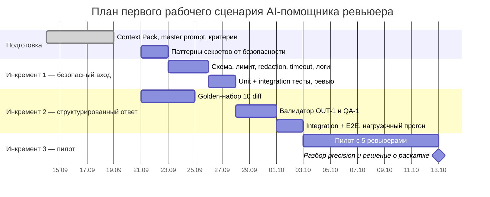

# План поставки

Порядок инкрементов выбран по риску: сначала закрываем то, что опасно (секреты, зависания), потом то, что делает помощника полезным (структура и evidence), и только затем меряем ценность на пилоте.

## Инкременты и ответственность

| Инкремент | Наблюдаемый результат | Что делает человек | Что делает AI или субагент | Проверка | Зависимости |
|---|---|---|---|---|---|
| 1. Безопасный вход (US-2, US-3) | `ReviewRequest` (422), лимит 20 000 (413), redaction секретов, timeout 10 с (504/503), логи по OBS-1 | Инженер: утверждает список паттернов секретов, ревьюит код и тесты, мёржит | Кодинг-агент: пишет схему, `redact()`, обёртку timeout и unit-тесты по [`tests_unit.md`](tests_unit.md) U-01…U-04; не мёржит и не меняет правила | U-01…U-04, INT-02, INT-04, E2E-02, E2E-03 зелёные в CI | Паттерны секретов от команды безопасности; LLM-клиент поддерживает timeout |
| 2. Структурированный ответ (US-1) | Ответ по OUT-1, `risks ≤ 3`, риски без дословного evidence отбрасываются (QA-1); master prompt из [`prompts.md`](prompts.md) хранится в репозитории | Инженер: фиксирует master prompt и golden-набор из 10 diff с ожидаемыми рисками, оценивает ответы | LLM (в проде): генерирует разбор по master prompt. Кодинг-агент: пишет парсер/валидатор ответа и integration-тесты | U-05, U-06, INT-01, INT-03; на golden-наборе ≥ 95 % рисков с верным evidence | Инкремент 1; утверждённый master prompt |
| 3. Пилот и замер ценности | 5 ревьюеров пользуются помощником 2 недели; у каждого риска кнопка «полезно / нет» | Тимлид: выбирает ревьюеров, раз в неделю разбирает отклонённые риски и правит Context Pack | AI-субагент: раз в неделю группирует отклонённые риски по причинам (черновик для тимлида, решение за человеком) | Precision ≥ 60 %, p95 ≤ 12 с по логу OBS-1 ([`problem.md`](problem.md#метрики)) | Инкременты 1–2; нагрузочный прогон [`tests_load.md`](tests_load.md) |

## Диаграмма Ганта

## Как использовали AI

- Для чего: получить черновик разбиения на инкременты и ролей человек/AI (P1-03).
- Тип промпта: master prompt.
- Строка в [`prompts.md`](prompts.md): P1-03.
- Что проверили и исправили сами: модель предложила 4 инкремента (размер → секреты+логи → LLM+timeout → OUT-1/QA-1). Мы объединили первые три в «безопасный вход», потому что по отдельности они не дают проверяемого пользователю результата, а четвёртый оставили как инкремент 2. Инкремент 3 (пилот и замер precision) модель не предлагала — добавили сами, иначе нельзя проверить метрику из [`problem.md`](problem.md). Сроки и зависимость от паттернов секретов — наши.
