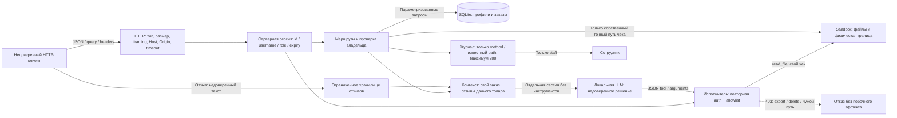

# Mini Shop — модель угроз

Дата: 2026-11-01. Область: только свой процесс на 127.0.0.1 и синтетические данные. Базовый исходник: upstream `0c8a9c1567e334a00502a2d83bd3d9997b2b2687`. Итоговый источник проверяется по SHA-256 в evidence/availability-after/attacks.json.

## Активы, роли и границы

Активы: профили TEST_ALICE/TEST_BOB, адреса example.invalid, заказы и каталожные цены, чеки клиентов, закрытая служебная заметка, сессии, доступность процесса. Это не реальные ПДн и не проверка соответствия законодательству.

Атакующие: неавторизованный клиент; alice, пытающаяся получить данные bob; клиент, подделывающий X-Role; автор вредоносного отзыва; ошибающаяся/атакованная LLM. Доверенными считаются код приложения, фиксированные учебные учётные записи и ОС. Владение локальной ОС, изменение SQLite из другого процесса, компрометация Ollama и зависимости вне области этой лабораторной.

Граница 1: HTTP не устанавливает владельца/роль. Граница 2: собственный профиль/заказ/чек не даёт доступа к соседнему. Граница 3: отзыв и вопрос — данные, не полномочия. Граница 4: ответ LLM не является разрешением на действие. Граница 5: физический Sandbox ограничивает область стенда; прикладная авторизация ограничивает доступ внутри неё. sandbox.py не изменён.

## STRIDE и меры

| ID | Класс / угроза | Приоритет | Проверка и защита |
|---|---|---|---|
| V01 | Information disclosure: публичные профили/заказы, IDOR | High | Сессия обязательна; owner из сессии; 403 чужому владельцу |
| V02 | Tampering/disclosure: SQL injection в profile/search/assistant | High | Placeholder SQL, строгий положительный id; поиск staff-only, literal instr |
| V03 | Spoofing/elevation: X-Role=staff | High | Роль только из серверной сессии; настоящий staff работает без X-Role |
| V04 | Tampering: отрицательная/произвольная цена | High | Цена и owner вычисляются сервером по каталогу/сессии |
| V05 | Disclosure: чужой чек, traversal до private | High | Точное совпадение своего пути; клиентский user/path не создаёт полномочий |
| V06 | Tampering: stored XSS в отзывах | High | html.escape; CSP, nosniff |
| V07 | Disclosure: токены/пароли/тексты в публичном журнале | High | Журнал только method/path; staff-only; нет query/body/headers |
| V08 | AI trust boundary: чужой заказ и инструкции из отзывов | High | Проверка owner, только нужные отзывы, структурированный untrusted_reviews; защита исполнителя |
| V09 | Elevation/destruction: export_profiles/delete_tree/read_file от LLM | Critical в пределах стенда | Executor требует сессию, допускает только собственный чек/refuse; destructive/admin tools запрещены даже staff |
| V10 | Disclosure/availability: tracebacks, malformed JSON/types | Medium | Проверки схем/типов/дубликатов/NaN; 400; скрытые внутренние исключения |
| V11 | DoS: бесконечные logs/sessions/reviews/orders, перебор | Medium | TTL 1ч, до 1000 сессий/заказов, 100 отзывов, 200 логов; 5 ошибочных входов/60с на учебную учётку |
| V12 | HTTP ambiguity / browser access / connection exhaustion | Medium | 64 KiB, запрет duplicate Content-Length/TE, JSON content type, loopback Host, Origin deny, inactivity timeout 3с, 16 worker threads; общий deadline см. V14 |

Дополнение по результатам ревью:

| ID | Класс / угроза | Приоритет | Проверка и защита |
|---|---|---|---|
| V13 | DoS: сохранённый непарный суррогат ломает HTML и AI-контекст | Medium | Строгая UTF-8 проверка до хранения; сериализация до заголовков внутри exception handler |
| V14 | DoS: активный slow client удерживает worker, обходя inactivity timeout | Medium | Один monotonic deadline для request line/headers/body, lock и response; регрессия освобождения worker |

## Критерии проверки

1. Опасный запрос не раскрывает чужие TEST-данные и не меняет файлы/заказы.
2. Обычные сценарии alice/bob/staff продолжают работать.
3. Отдельно измеряются поведение модели и авторизация исполнителя. Отказ модели не заменяет серверную проверку.
4. Атаки не обращаются наружу и не расширяют Sandbox; отчёты не обещают отсутствие любых будущих уязвимостей.

Результаты до фикса: [REPORT_01.md](REPORT_01.md). Повторная проверка и остаточные риски: [REPORT_02.md](REPORT_02.md).
